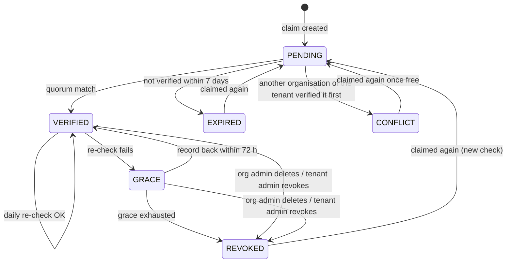

# DESIGN: Organisation domain verification

Status: design, accepted for implementation (October 2026). Owner: Charles Sibbald.
Decision record: [ADR-007](ADR-007-tenant-domain-verification.md), amendment of 2026-10-10.
Mechanism shared with tenant issuer domains: [DESIGN-tenant-domain-verification.md](DESIGN-tenant-domain-verification.md)
(sections 2 to 5: token, record, resolution, lifecycle). This document covers what differs for organisations.

An organisation proves it controls an email domain (`bigbank.com`) by publishing a DNS TXT record Sesame gives it.
Sesame then trusts the organisation, and only it, to vouch for addresses in that domain, and keeps checking every day.

---

## 1. Who relies on it

| Consumer | Rule |
| --- | --- |
| SAML first-time linking and just-in-time provisioning (DESIGN-saml-sp.md §6) | only for an email in a domain the organisation holds in state VERIFIED |
| "Sign in with SSO" discovery | an email domain routes to the organisation's SAML connection only if VERIFIED or GRACE |
| Domain-based auto-join (organisation settings) | only for VERIFIED domains with `auto_join` set |
| Existing SAML identities | not affected: bound to (connection, NameID), not to DNS |

Today `org_domains` has a writable `verified` flag and `update_org_domains` is a stub whose request lets an admin
simply declare domains. Both go: a domain becomes usable only by being proven.

## 2. The claim

A claim is (`tenant_id`, `org_id`, `domain`, `scope`):

- `domain`: lower-cased, IDNA A-label (RFC 5890), no trailing dot, at most 253 octets.
- `scope`: `exact` (default: addresses `@bigbank.com` only) or `subdomains` (also `@eu.bigbank.com`, …), an explicit
  choice, proven at the same name (the domain itself).
- **Not claimable**: a public suffix or anything above a registrable domain (Public Suffix List, pinned and refreshed
  with each release); consumer mail providers (`gmail.com`, `googlemail.com`, `outlook.com`, `hotmail.com`, `live.com`,
  `yahoo.com`, `icloud.com`, `proton.me`, `gmx.*`, … a maintained list); domains of the deployment itself.
- **One holder per tenant**: while a claim is VERIFIED or GRACE, no other organisation of the same tenant can verify
  that domain. Several may be PENDING; the first to verify wins and the others fail with `domain_unavailable`. Tenants
  are isolated, so two tenants may each have an organisation holding the same domain.

## 3. Token and record

```
purpose = "sesame-org-domain"
token   = base64url( HMAC-SHA256( K_enroll_epochN,
              tenant_id || 0x00 || org_id || 0x00 || fqdn || 0x00 || scope || 0x00 || purpose || 0x00 || "v1" ) )

_sesame-challenge.<domain>   TXT   "sesame-domain-verify=v1;t=<token>"
```

- Same key, epochs, record name and value form as tenant issuer verification; `org_id`, `scope` and `purpose` in the
  PRF input bind the record to this organisation, this scope and this kind of claim. A record for another
  organisation, another scope, or an issuer claim never matches.
- Several `sesame-domain-verify` strings may sit at the same name (organisations of other tenants, an issuer claim);
  verification looks for its own token among them.
- Stateless: any replica recomputes the expected token; nothing secret is stored per claim.

## 4. Resolution

As the shared design §4: two independent DNS-over-HTTPS resolvers on different providers must both return the record;
DNSSEC must validate where the zone is signed (recorded either way); constant-time comparison; CNAME at the challenge
name followed (delegated verification); negative caching respected (60 s floor, backoff to 1 h while PENDING).

## 5. Lifecycle



| State | Discovery | First-time SAML link / JIT | Auto-join | Existing links |
| --- | --- | --- | --- | --- |
| PENDING, EXPIRED, CONFLICT | no | no | no | work |
| VERIFIED | yes | yes | yes, if set | work |
| GRACE | yes | **no** | **no** | work |
| REVOKED | no | no | no | work; admins alerted |

Grace is stricter than for issuers: a DNS outage must not stop people signing in, but nothing new is bound to a domain
whose control is in doubt. Every transition notifies the organisation's admins (and the tenant's for REVOKED) and
writes an audit event.

## 6. API (org-mgmt, organisation-scoped)

| operationId | Method, path | Who | Notes |
| --- | --- | --- | --- |
| `create_org_domain` | `POST /organizations/{org_id}/domains` | org admin | `{domain, scope}` → `201 {id, domain, scope, state: PENDING, record: {name, type, value}, pending_until}`; eligibility (§2) checked here |
| `list_org_domains` | `GET /organizations/{org_id}/domains` | org members | states, `verified_at`, `last_verified_at`, `dnssec`, `auto_join` |
| `verify_org_domain` | `POST /organizations/{org_id}/domains/{domain_id}/verify` | org admin | check now; rate-limited (one per minute per claim) |
| `update_org_domain` | `PATCH /organizations/{org_id}/domains/{domain_id}` | org admin | `{auto_join}`; only when VERIFIED |
| `delete_org_domain` | `DELETE /organizations/{org_id}/domains/{domain_id}` | org admin | immediate REVOKED |
| `revoke_org_domain` | `POST /tenants/current/org-domains/{domain_id}/revoke` | tenant admin | immediate REVOKED, with reason |

`update_org_domains` (primary, extra and auto-join domains declared in one request) is removed. No API sets a claim's
state: only the verifier does. The organisation comes from the path and the validated token, never from a header
(FINDING-2026-07-25). Errors do not reveal whether another organisation holds a domain beyond `domain_unavailable`.

## 7. Where the work runs

- **`sesame-common::domain_verify`** (library): normalisation and eligibility (IDNA, Public Suffix List, provider
  list), token derivation for both purposes, the DoH quorum client (rustls, DNS wire format, AD bit), comparison. Used
  by org-mgmt now and by the tenant issuer registry (ADR-004) when it is built: one implementation, two subjects.
- **org-mgmt**: the API; first verification inline (`verify_org_domain`) or by polling while PENDING.
- **Re-verification**: `sesame_domain_reverify`, a binary of the suite run as a CronJob (hourly; each run checks the
  claims due, daily per claim, jittered, never faster than the record's TTL), with its own database login; one run at a
  time (`concurrencyPolicy: Forbid`).
- **Egress**: HTTPS to the chosen DoH providers only (two of Cloudflare, Google, Quad9, from configuration).
- **Secret**: `K_enroll` from the secret backend (ADR-006 chain), never in git; mounted into org-mgmt and the
  re-verification job only.

## 8. Data

```sql
ALTER TABLE sesame_idam.org_domains
    ADD COLUMN tenant_id         VARCHAR(64),          -- RLS; backfilled from the organisation, then NOT NULL
    ADD COLUMN scope             VARCHAR(16) NOT NULL DEFAULT 'exact',     -- exact | subdomains
    ADD COLUMN state             VARCHAR(16) NOT NULL DEFAULT 'PENDING',   -- PENDING VERIFIED GRACE REVOKED EXPIRED CONFLICT
    ADD COLUMN epoch             INTEGER NOT NULL DEFAULT 1,
    ADD COLUMN dnssec            BOOLEAN,
    ADD COLUMN pending_until     TIMESTAMPTZ,
    ADD COLUMN verified_at       TIMESTAMPTZ,
    ADD COLUMN last_checked_at   TIMESTAMPTZ,
    ADD COLUMN last_verified_at  TIMESTAMPTZ,
    ADD COLUMN grace_until       TIMESTAMPTZ,
    ADD COLUMN auto_join         BOOLEAN NOT NULL DEFAULT false,
    ADD COLUMN created_by        UUID;
-- existing rows: state PENDING whatever "verified" said (it was never proven); then drop "verified".
CREATE UNIQUE INDEX org_domains_one_holder ON sesame_idam.org_domains (tenant_id, domain)
    WHERE state IN ('VERIFIED', 'GRACE');

CREATE TABLE sesame_idam.org_domain_events (          -- append-only
    id UUID PRIMARY KEY DEFAULT gen_random_uuid(),
    tenant_id VARCHAR(64) NOT NULL,
    org_domain_id UUID NOT NULL REFERENCES sesame_idam.org_domains(id) ON DELETE CASCADE,
    at TIMESTAMPTZ NOT NULL DEFAULT now(),
    event VARCHAR(32) NOT NULL,                          -- created checked verified grace revoked expired conflict deleted
    detail JSONB NOT NULL DEFAULT '{}'                   -- resolvers, dnssec, failure reason; never the token
);
```

Tenant RLS on both (ADR-005); writes through Lifeguard models; the state transitions are one function, so the API and
the job cannot diverge.

## 9. Threats

| Threat | Answer |
| --- | --- |
| An organisation claims a domain it does not control | it cannot publish the record |
| Claiming `gmail.com` or a public suffix | ineligible (§2) |
| A lapsed domain re-registered by someone else | daily re-check: GRACE within a day, nothing new bound, REVOKED after 72 h |
| One poisoned or coerced resolver | quorum of two providers; DNSSEC where signed |
| A record copied from another organisation or tenant | PRF binds tenant, organisation, scope and purpose |
| A subdomain taken over (dangling CNAME) | `exact` by default; `subdomains` is an explicit claim |
| A tenant or org admin marking a domain verified | no API sets state |
| `K_enroll` leaked | tokens become predictable, but the record must still be published in the zone (ADR-007) |
| Learning which organisations hold a domain | generic `domain_unavailable`; discovery answers the same for unknown domains |

## 10. Testing

- Token vectors (both purposes, epoch rotation overlap), normalisation and IDNA, Public Suffix List and provider list.
- Resolver: a mock DoH pair covering agreement, disagreement, one failure, AD bit set and missing on a signed zone,
  CNAME, several TXT strings, TTL floor.
- Lifecycle: the transition function under a simulated clock (property tests over random event sequences: no path
  reaches VERIFIED without a quorum match; GRACE never binds anything new).
- API: only org admins of the organisation; tenant isolation; no way to set state; conflict handling.
- Live: a delegated test zone in the deployment's DNS, records created and removed by the test itself.

## 11. Order of work

1. `sesame-common::domain_verify` with its tests.
2. Schema migration; org-mgmt API (§6); first verification.
3. `sesame_domain_reverify` CronJob; notifications.
4. Consumers: SAML discovery, first-time linking and JIT (DESIGN-saml-sp.md), auto-join.
5. Later: the tenant issuer registry (ADR-004) on the same library.
