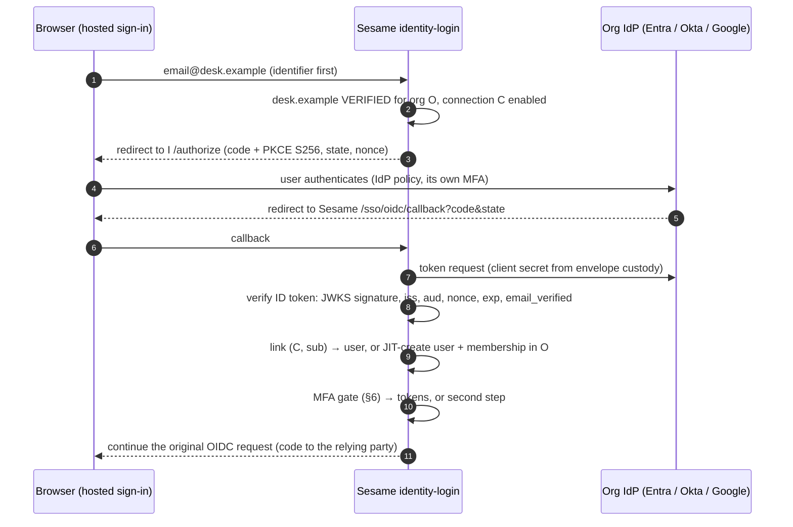

# DESIGN: organisation single sign-on (OIDC and SAML), self-service

Status: PROPOSED (October 2026) — for Charles to decide; nothing here is built yet.
Related: Epic 17 ([README](Epics/17-enterprise-sso-saml/README.md)), [DESIGN-saml-sp.md](DESIGN-saml-sp.md),
[ADR-007](ADR-007-tenant-domain-verification.md) (domains), [ADR-008](ADR-008-authentication-assurance-passkey-first-mfa.md)
(assurance), [ADR-011](ADR-011-platform-tenant-authority-separation.md) (authority), ADR-014 (SAML verification),
roadmap P3 (FR-P3-005, AC-P3-004), [DESIGN-mfa-passkeys.md](DESIGN-mfa-passkeys.md).

## 1. What "completing the OAuth work for orgs" refers to

The code has three half-finished pieces under that name. They are different things:

| Piece | State today | What it is |
|---|---|---|
| **A. Tenant social sign-in config** (Google, Microsoft) | Works, but configurable only with the platform operator key (`/platform/tenants/{slug}/oauth/{provider}`); client secrets read from env vars named in the database. Stock-take 2026-07-25 §1, **Task 33**. | A *tenant* (PriceWhisperer) letting its users sign in with Google or Microsoft. ADR-011 says a tenant must be able to do this itself. |
| **B. Organisation OIDC SSO** | `POST /organizations/{org_id}/oidc-metadata` (`set_oidc_idp_metadata`) is a generated stub, not wired (answers 501). No per-organisation OIDC relying-party code; the social-login code is hard-wired to Google and Microsoft endpoints. | An *organisation* (a trading desk, a hauliage company) signing its members in through its own Entra ID, Okta or Google Workspace over OIDC. |
| **C. Organisation SAML SSO** | Epic 17: domain verification done (17.1–17.4), `dns-probe` built (not deployed), `saml-verifier` in progress (17.6), connections, ACS, JIT and UI not started (17.8–17.18). | The same as B over SAML, for IdPs or customers that only do SAML. |

Org-scoped OAuth *client* registration (a relying party registering its own OIDC client) is already done and
self-service (`/tenant/oidc/clients`, Epic 11/12), so it is not what is unfinished.

**Reading of the request**: "OAuth work for orgs" is B (organisation OIDC SSO, the stubbed endpoint), with A as a
prerequisite (the same self-service and secret-custody rules apply) and C as the same feature over the other
protocol. This design covers B fully, A as a short prerequisite, and how B and C share one connection model and one
sign-in path so SAML lands into it rather than beside it.

## 2. Outcome

An organisation admin, without help from the platform:

1. proves the organisation's email domain (ADR-007 DNS TXT — built);
2. creates an SSO connection: OIDC (issuer URL, client id and secret from their IdP) or SAML (IdP metadata URL);
3. copies the redirect URI / ACS URL Sesame shows into their IdP;
4. runs a test sign-in, then enables the connection;
5. optionally requires SSO for everyone on the verified domain.

A member then types their work email on the hosted sign-in, is sent to their IdP, and comes back signed in to
PriceWhisperer with ordinary Sesame tokens. First-time users are created and added to the organisation (just in time).
SCIM provisioning comes later (§8).

## 3. Model

One table for both protocols, organisation-scoped and tenant-isolated (RLS as everywhere):

`org_sso_connections` — `id`, `tenant_id`, `org_id`, `protocol` (`oidc` | `saml`), `status` (`draft` → `testing` →
`enabled` | `disabled`), `display_name`, `require_for_domain` (bool), `trust_idp_mfa` (bool, §6), `created_by`,
timestamps; OIDC: `issuer`, `client_id`, `client_secret_sealed` (ADR-009 envelope, the KEK Sesame already holds),
`scopes`, `claim_map` (email, name, groups), cached discovery and JWKS with fetch times; SAML: as story 17.8.

`org_sso_links` — `(connection_id, subject)` → `user_id`. Existing links bind to the IdP's stable subject, never to
an email address, so a re-verified or lapsed domain never re-points an existing account (Epic 17 "trust in email").

Org domains (`org_domains`, built) decide routing and just-in-time provisioning: only a domain in state VERIFIED
routes to a connection or provisions a user, and only into the organisation that holds it.

## 4. Sign-in flow (OIDC)

* The `may_minihttp` client (HTTPS via rustls, BRRTRouter) fetches discovery, JWKS and tokens; org-mgmt validates the
  issuer URL at creation (https only, no private addresses: the SSRF guard 17.9 needs anyway).
* A new `sso_login` endpoint replaces nothing: the hosted page asks `/auth/sso/discover?email=` (or the relying party
  passes `login_hint`/`org` on `/oauth/authorize`), and only offers SSO when a connection exists — the same
  identifier-first page the passkey button sits on.
* The callback resumes the hosted sign-in's pending authorization request (the `request_id` rides in `state`), so the
  relying party sees an ordinary authorization code.

## 5. Self-service setup

org-mgmt (organisation owners and admins; ADR-011 tenant authority, never the platform key):

| Endpoint | Purpose |
|---|---|
| `POST /organizations/{org}/sso/connections` | create (draft); OIDC fields or SAML metadata URL |
| `GET …/connections`, `GET/PATCH/DELETE …/connections/{id}` | manage; secrets write-only |
| `POST …/connections/{id}/test` | start a test sign-in (status `testing`; only the admin's own account) |
| `POST …/connections/{id}/enable`, `…/disable` | lifecycle, audited |
| `GET …/connections/{id}/setup` | what to paste into the IdP: redirect URI / ACS URL, SP metadata |

The existing `oidc-metadata` stub becomes the create endpoint (or is removed from the spec). Console UI: the
organisation settings page in the tenant console (and a PriceWhisperer team-settings page through the trader BFF).

**Task 33 first** (2–3 days): `/tenant/oauth/{provider}` GET/PUT/rotate for tenant admins (bearer, tenant from the
token), client secrets moved from env-var names into envelope custody. B reuses the same custody and the same
secret-write-only API shape.

## 6. Assurance (ties into ADR-008)

An SSO sign-in is a federated first factor (`amr: ["fed"]`, `aal1`) unless the connection says otherwise:

* `trust_idp_mfa = false` (default): Sesame's own gate applies — a member with a passkey or authenticator app (or in
  an organisation whose Sesame policy requires one) completes a second step in Sesame after the IdP.
* `trust_idp_mfa = true`: when the IdP's ID token reports MFA (`amr` containing `mfa`, or an `acr` the admin mapped to
  MFA), Sesame records `amr: ["fed", "mfa"]` and `acr: aal2` and skips its own second step. Organisations that run
  MFA at their IdP (most enterprises) want this; it is their IdP's word, so it is opt-in per connection and the
  claims say `fed`.
* Never `aal2-phishing-resistant` from an IdP assertion: Sesame cannot see the origin binding.

`require_for_domain`: when on, users on the verified domain cannot sign in with a password or emailed code (the
hosted page sends them to the IdP). Break-glass: the organisation's owners keep their Sesame password and passkey
(FR-P3-005 "break-glass recovery").

## 7. What blocks it, and effort

| # | Blocker | Effort |
|---|---|---|
| 1 | **Task 33** — tenant OAuth self-service + envelope custody for client secrets (ADR-011 violation still live). | 2–3 days |
| 2 | **`saml-verifier` pinned to BRRTRouter `7066f6c`** while the workspace is on `cbebc84` (response validation `full`, regenerated gen crates, the 3.1 nullable fix). It is a separate workspace (libxmlsec1), so it must be regenerated and re-tested on the current pin before SAML (C) can ship; OIDC (B) does not depend on it. | 1–2 days |
| 3 | Outbound HTTPS from identity-login and org-mgmt to arbitrary IdPs (discovery, JWKS, token): network policy and egress in pp (gcp-infrastructure), plus the SSRF guard. Today identity-login only reaches Google and Microsoft. | 2–3 days incl. GitOps |
| 4 | Story 17.5 (daily domain re-verification) and 17.17 (`dns-probe` deployment): without them a domain, once verified, stays verified — routing and JIT must not rely on that. | 1 week (already planned) |
| 5 | Hosted sign-in identifier-first discovery and the SSO resume path (shared with 17.15). | 3–4 days |
| 6 | Connection admin API + console UI + PriceWhisperer team page. | 1–1.5 weeks |
| — | **OIDC (B) total**, given 1, 3, 5, 6 | **≈ 3–4 weeks** |
| — | **SAML (C)**: rest of Epic 17 (17.6–17.18) on top of B's model and flow | **≈ 5–7 weeks** |
| — | **SCIM** (§8) | **≈ 2–3 weeks** |

Recommended order: Task 33 → OIDC connections (B) with Entra ID and Google Workspace as the first two IdPs (both speak
OIDC; it proves the model and the flow without the XML risk) → SAML (C) on the same connection table → SCIM.

## 8. SCIM later

org-mgmt already has generated SCIM 2.0 endpoints (`/organizations/{org}/scim/users|groups`, stubs). SCIM needs a
per-connection bearer token (an org-scoped API key from the api-keys service), the user/group profile from
FR-P3-006, deactivation that revokes sessions (`rfam` revoke for every session of the user), and group-to-role
mapping (the stubbed role-mappings endpoints). It is independent of the sign-in path and can follow either protocol.

## 9. Decisions for Charles

1. Is the reading in §1 right — organisation OIDC SSO first (B), Task 33 as the prerequisite, SAML after?
2. First IdPs for OIDC: Entra ID and Google Workspace (Okta via SAML in C, or OIDC as well)?
3. `trust_idp_mfa` default off (Sesame's own second step after the IdP) or on for connections whose IdP asserts MFA?
4. Is `require_for_domain` (SSO-only for a verified domain) wanted in the first cut, with owners as break-glass?
5. PriceWhisperer surface: SSO setup in the trader app's team settings (through the BFF), in Sesame's tenant console,
   or both?
